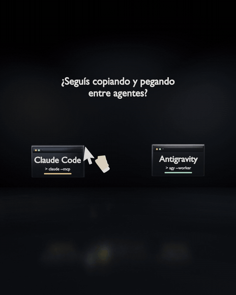
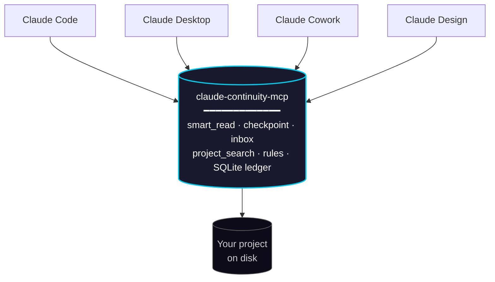

# claude-continuity-mcp — Your AI Agents, Working as a Team

[](https://github.com/gabicacabelos/claude-continuity-mcp/actions/workflows/tests.yml)

<p align="center">
  <a href="docs/media/presentation.mp4"></a>
</p>

**Your agents stop waiting for you to carry messages.** Claude Code hands a task to Antigravity, goes idle, and wakes up
by itself the moment the reply lands. And they all share one project memory that survives `/compact` and new sessions.

An MCP server that gives Claude something it doesn't have today: **memory that persists across sessions and is shared across all its clients** (Code, Desktop, Cowork, and — bridged, see below — Design). It remembers which files you already read and returns only the diffs, resumes tasks where you left off, and coordinates orders between clients. 100% local and deterministic at its core, no API keys — the one exception is the Design bridge, which needs Google Drive since Design has no local access.

▶ **Presentation video** (22 s, in Spanish, with sound):

https://github.com/user-attachments/assets/fbd40a9f-42fa-4866-9ee3-8902cb4caa3a

## The live inbox: hand off, go idle, wake up

```text
Claude Code   router_inbox send → antigravity        ← gets a ready watch_cmd, runs it in the background, ends its turn
Antigravity   (next tool call) inbox_alert: new_orders [1]
Antigravity   claim 1 → claimed                       ← a second agent trying the same order is refused
Antigravity   complete 1 "Toggle works on both plans…"
Claude Code   watcher exits 0 with the reply → resumes by itself (7.5 s in a real run)
```

- **Nobody asks "check the inbox":** every tool response carries an `inbox_alert` when orders or replies arrive.
- **Never done twice:** `claim` is atomic, so an order sent to `any` is executed by exactly one agent.
- **Wake-up on reply:** `claude-continuity-watch` exits the moment the answer lands. Works in agents that resume when
  a background command finishes (Claude Code, Antigravity). Other MCP clients see new orders on their next call.
- **Local and safe:** a SQLite file on your machine. Nothing executes an order on its own; order text is untrusted data.

[How it works](#live-inbox-v39) · tested on a clean Windows profile in PowerShell, cmd and bash · 415 tests on Windows, macOS and Linux.

**Also:** memory across sessions and clients, a compaction shield, "why did we do this?", project rules and an honest
savings report (below).

**New in v3.10:**
- 🔁 **Handoff and autosave** — when Claude Code stops mid-task, another agent can pick up where it left off: an automatic checkpoint every turn, a `HANDOFF.md` and a text to paste into a web chat ([details](#handoff-and-autosave)).

**New in v3.8:**
- 🛡️ **Compaction shield** — Claude Code no longer forgets your requests, open tasks and project rules after `/compact` ([details](#compaction-shield-claude-code)).
- 🧾 **"Why did we do this?"** — the decisions behind any line or function: `router_checkpoint action=why ref=src/auth.py:120`.
- 📊 **Shareable savings card** — a 1200×630 image of what the MCP saved you this week, with no file or project names in it.
- 🔀 **Any MCP agent** — the same memory for Cursor, Codex, Gemini CLI, VS Code / Copilot, Windsurf… ([setup](#other-agents-cursor-codex-gemini-cli-vs-code--copilot-windsurf)).

**Also on Agensi:** the companion skill is free on the [Agensi marketplace](https://www.agensi.io/skills/project-continuity-persistent-memory-for-coding-agents) ([more from the author](#more-from-the-author)).

## What this actually does (in plain English)

Claude forgets everything the moment a conversation ends, and it can't share anything between its different apps — what you told Claude Code doesn't exist for Claude Desktop. This project fixes that by keeping a small memory file on your own computer, shared by every Claude app you use.

Once it's installed, in practice:

- **You stop re-explaining your project every time.** Claude remembers which files it already read. Nothing changed? It skips straight to the point. Something changed? It only reads the change, not the whole file again.
- **You can pick up work exactly where you left it — even in a different app.** Save a quick note in one Claude app, resume it from any other, decisions and pending tasks intact.
- **You can leave a task for another app to finish.** Tell Cowork to leave a job for Claude Code; it picks it up, does it, and reports back — even though the two can't talk to each other directly.
- **You can teach it a permanent rule, once.** *"Never use Redux in this project"* — say it once, and it shows up automatically from then on, in any app, without you repeating it.
- **You can ask "where in my whole project is X handled?"** — not just in one file, across the entire codebase — and get the exact files and line numbers, not a guess.

It never summarizes your files with another AI to save space — you always get the real, exact content. And everything stays on your machine: no accounts, no API keys, nothing sent anywhere.

**Who this is for:** anyone who uses more than one Claude app (say, Claude Code *and* Claude Desktop, or Cowork) on the same project over multiple sessions. If you only ever have one quick chat at a time, this won't change much for you — and that's fine, it's not built for that.



Four different clients, one shared state: whatever one reads, decides, or leaves pending, any of the others inherits.

## Why it exists

Claude is amnesiac across sessions and blind across clients: what you read in Claude Code doesn't exist for Claude Desktop, and every new session re-reads the same files as if it were the first time. This MCP is the same local process shared by all your clients, with state persisted to disk — it's the memory Claude doesn't have. The token savings it produces are real, but they're a consequence, not the pitch: what sets the project apart is **continuity**.

## What it is — and what it is NOT

**It is:**

- Continuity: what was read/decided in one session stays available in the next, and in any other client.
- A layer so that 20,000-token files don't enter Claude's context whole when you only need 400.
- Deterministic where it matters: `smart_read` returns *exact* fragments of the file (local BM25/embeddings ranking) and *exact* diffs — never lossy summaries generated by a weaker model.

**It is NOT:**

- A "magic token saver" for your daily chat. If your session is normal conversation, this won't help you — and no tool will.
- A code compressor. Compressing code with cheap LLMs degrades Claude's answers and ends up costing more in retries. Never done here.

> **Note:** bulk processing on free models (formerly `router_bulk_process`) was split into its own repo, [`individra-bulk-offload`](https://github.com/gabicacabelos/individra-bulk-offload), because it's a different product: it depended on external services that diluted this 100%-local core.

## The 6 tools

### `router_smart_read` — Surgical reading with memory (local, $0, no APIs)

*In short: reads files smartly, remembers what it already saw, and only shows you what changed.*

```
smart_read(file_path="docs/manual.md", query="where are webhooks configured?")
→ the 2-4 exact relevant fragments, with line numbers
```

- Small file (≤ ~6KB): returned whole, cleaned up.
- Large file + `query`: hybrid chunking + ranking (fastembed if installed, pure-Python BM25 if not) → only the relevant fragments. Typical savings: 70-90% of the file, **zero loss of fidelity**.
- Large file without `query`: structural map (outline with line numbers) to decide what to ask for.
- HTML: cleaned locally (scripts, tags, boilerplate stripped) before processing.

**Cross-session memory (diff reads):** every read gets recorded (hash + snapshot in a local SQLite file). In any future session, on any client:

- Unchanged file → `{"status":"unchanged","outline":[...]}` — ~50-100 tokens instead of thousands. In tests: 90 tokens vs. 10,195 for the file.
- Modified file → **only the unified diff** against the snapshot (99%+ measured savings).
- `force_full=true` skips memory when you need the full content.

### `router_checkpoint` — Context handoff between sessions and clients

*In short: save your progress, resume it later — from any Claude app.*

```
checkpoint(action="save", name="refactor-auth",
           summary="Login migrated to JWT, refresh token still pending",
           decisions=["use RS256"], open_items=["expiration tests"],
           files=["src/auth.py"])
```

When closing a long task (or when context is filling up), Claude saves the state as human-readable JSON in `checkpoints/` — editable by you, shareable with your team. A new session — on Desktop, Code, or Cowork, doesn't matter — calls `action="resume"` and recovers everything in ~300 tokens, **including which files changed on disk since the checkpoint** (hash comparison, no re-reading). `action="list"` shows the available checkpoints.

**Stale-memory check:** a memory that quotes old code is worse than no memory — the model repeats it with full confidence. When saving, the checkpoint anchors every reference in its text that is true *right now*: `src/auth.py:120` (with the exact text of that line) and code symbols in backticks like `` `validate_token()` `` (with the files that contain them). On `resume`, each anchor is checked against the current code and reported in `verification.issues`:

| Issue | Meaning |
|---|---|
| `file_missing` | the referenced file no longer exists |
| `line_moved` | the quoted line is still there, at `now_line` |
| `line_changed` | the quoted line is gone — the claim may no longer hold |
| `symbol_missing` | the function/class isn't in any of the files that had it (renamed or removed?) |

If anything fails, the payload carries a `memory_warning` telling Claude to verify before trusting the summary and decisions. References that were already false when saving are never anchored, so they can't become false alarms. Checkpoints saved before v3.6 get a conservative check (absolute paths that no longer exist).

**"Why did we do this?" (`action="why"`):** like `git blame`, but for the decisions you made with your agent.

```
checkpoint(action="why", ref="src/auth.py:120")   # also "src/auth.py" or "validate_token()"
→ the checkpoints whose anchors point at that line (±20), then those that tracked or mentioned the file,
  with their decisions; completed inbox orders that mention it; and the project's rules
```

Every matching checkpoint is checked against today's code: if the line it cited changed, the entry says `still_valid: false` with the `drift`, so an old decision isn't applied blindly.

**Cold start (no checkpoints saved):** `resume` never returns empty-handed. If nobody saved a checkpoint, it reconstructs a deterministic digest from the ledger and inbox — the last files touched (and whether they changed on disk since), plus recently completed orders. The payload declares `"mode": "reconstructed_activity"` explicitly: it's an activity trace, **not** an intentional checkpoint, and contains no architectural decisions.

### `router_inbox` — Cross-client orders

*In short: leave a task for another Claude app to pick up, run, and report back on.*

```
# In Cowork:
inbox(action="send", to="code", message="migrate the tests to pytest",
      checkpoint="refactor-auth")

# In Claude Code, on startup:
inbox(action="check", to="code")
→ the order + the linked checkpoint summary
inbox(action="complete", order_id=1, result="34/34 tests green")

# Back in Cowork:
inbox(action="history")  → you see the result
```

Claude chats can't command each other in real time — but they share this disk. The inbox is the async mailbox: you leave an order from one client (linked to a checkpoint so the receiver has the full context of what was being worked on), the other picks it up on startup, executes it, and reports the result. Tell Cowork *"leave this task for Claude Code"* and that's it — the server's `instructions` make each client check its inbox when starting work.

**Pack clients:** `cowork`, `code`, and `desktop` load this MCP directly — for any of them to receive orders, they just need it loaded and to check their inbox with `action="check"`. **`design` (Claude Design) is different and needs a caveat:** it's a cloud-hosted product with no access to your local filesystem, so it *cannot* load this MCP or call `action="check"` itself — despite `design` being a valid destination/origin value. Orders addressed to `design` have to be bridged by a client that does have the MCP (see below). The destination field is free text either way, so you can also invent your own roles for anything else you connect.

**Code ↔ design handoff (`assets`):** orders and results can carry `assets` — a list of file paths or URLs (brief, wireframe, `.fig`/`.png` export, specs). That way the back-and-forth between development and design travels with the material, not just the text:

```
# Claude Code asks Claude Design for a mockup, with the material:
inbox(action="send", to="design", from_client="code",
      message="landing hero, dark + cyan accent",
      checkpoint="landing-v2",
      assets=["/proj/brief.md", "https://.../wireframe.png"])

# Claude Design can't check this inbox itself. A client that HAS the MCP
# (Code or Cowork) relays the order into a shared Google Drive doc that
# Design's own Drive connector can read (see "Bridging Claude Design" below):
inbox(action="check", to="design")  → run by Code/Cowork, not by Design

# Claude Design reads the brief from Drive, builds the mockup, and drops
# the result as a Drive doc. The bridging client picks that up and closes
# the loop:
inbox(action="complete", order_id=7, result="mockup ready, 2 variants",
      assets=["https://figma.com/.../hero", "/exports/hero-v1.png"])

# Claude Code sees the result and the returned export:
inbox(action="history")  → result + result_assets
```

The inbox is bidirectional between `cowork`, `code`, and `desktop` natively. With `design`, it's bidirectional in effect but bridged — never direct.

**Bridging Claude Design (Google Drive as mailbox):** since Design can't reach your disk, a client that already has the MCP (Cowork or Code) writes the order as a Google Drive doc named `INBOX-DESIGN-order-<N>` (brief + linked checkpoint). Design — which does have a Google Drive connector — reads it from there, builds, and leaves the result as `INBOX-DESIGN-order-<N>-RESULT` with the published artifact URL. The bridging client reads that doc and closes the loop with `router_inbox complete`. It's semi-manual (someone has to trigger each hop) and it's the one part of this project that isn't 100% local — Drive is the intermediary precisely because Design has no other channel in. This convention is saved as a permanent project rule (`router_rules`), so any client resuming this project sees it without being told again.

**Traceability (`completed_by`):** `to` records who an order was **for**; `completed_by` (passed to `action="complete"` as `by`) records who actually **executed** it — and they can differ. If an order addressed to `design` gets executed by a client bridging on its behalf instead of the real Claude Design product, `completed_by` makes that visible instead of silently blending into "done". `history()` flags it explicitly with `executed_by_different_client: true` when the two don't match.

### Live inbox (v3.9)

An MCP server can't wake up an idle chat by itself. These four pieces get as close as possible, with no daemon and
nothing running in the background unless an agent asks for it:

| Piece | What it does | Works in |
|---|---|---|
| **`inbox_alert`** | When new orders arrive for you, or someone completes an order you sent, the next response of **any** tool carries a short `inbox_alert` (`new_orders`, `replies`). It only reports what's new, at most every 20 s. | Every MCP client |
| **SessionStart hook** | Opening or resuming a Claude Code session lists the pending orders for `code`. It prints nothing when there are none. | Claude Code plugin |
| **`claim`** | `router_inbox action=claim order_id=N` takes an order atomically and returns it whole (`message`, `assets`, `checkpoint_summary`), so no second `check` is needed. Other agents stop seeing it, so an order sent to `any` is never executed twice. An abandoned claim expires after 4 h. `check` without `to` now shows only your own orders plus `any`. | Every MCP client |
| **`claude-continuity-watch`** | Waits until a new order or a reply arrives, prints it as one JSON line and exits (0 = event, 3 = timeout). Agents that wake up when a background command finishes (Claude Code, Antigravity) launch it before ending their turn and resume as soon as the other agent answers. `send` returns the exact command as `watch_cmd`, with `--home` pointing at the same inbox even if your shell lacks `CLAUDE_CONTINUITY_HOME`. | Any agent with background commands |

Run the watcher (the package's second command):

```bash
uvx --from claude-continuity-mcp==3.10.0 claude-continuity-watch --to code --timeout 900
```

To wait for the reply to one specific order (`router_inbox action=send` already returns this line as `watch_cmd`):

```bash
uvx --from claude-continuity-mcp==3.10.0 claude-continuity-watch --to code --order 52
```

To type just `claude-continuity-watch`, put it on your PATH once:

```bash
uv tool install claude-continuity-mcp==3.10.0
```

**Hooks in other agents:** to peek once (for a session-start or pre-turn hook), run
`claude-continuity-watch --to <agent> --once --exit-zero`. It prints the pending orders as JSON, or `{}` when there are
none, and always exits 0, also on a machine where the MCP has never run yet. Without `--exit-zero`, "nothing" exits 3. If your agent's hook expects a specific output
contract, wrap it in a small adapter script. Antigravity, for example, expects `{"injectSteps": [...]}` or `{}`, and runs
its pre-turn hook before every model call: dedupe there.

**Safety:** order text is untrusted data, since any local process can write to the inbox. Every piece above only **reads
and notifies**: nothing executes an order on its own, and agents are told to show the literal text to the user before
anything hard to undo.

### `router_status` — Honest session metrics

*In short: check how much this is actually saving you — real numbers, no marketing.*

The headline metric is `tokens_kept_out_of_context`: tokens from the original sources that **didn't** enter Claude's context window. It also reports reads, memory hits (unchanged/diff), ledger state, and pending inbox orders. `deep=true` adds local diagnostics (fastembed/python).

### `router_project_search` — Search the whole project (incremental BM25)

*In short: "where in my whole project is X?" — answered with the exact file and line, not a guess.*

```
project_search(project_dir="/proj", query="where are webhook signatures validated?")
→ the most relevant files, each with its exact fragments and line numbers
```

`smart_read` answers *"where is X in **this file**?"*. The question you usually have is *"where is X **in the project**?"* — and that's where Claude falls back to Grep.

- **Incremental index:** the first call indexes; later calls only re-index files whose hash changed (unchanged files cost ~0). On this repo: 23 files in 0.41s cold, **0.08s warm**.
- **Persistent and shared:** the index lives in the ledger, so it survives across sessions and clients. Grep starts from zero every time; this doesn't.
- **Better than literal grep for concepts:** ranks by relevance and splits `snake_case`/`camelCase`, so "webhook retry" finds `handleWebhookRetry()`.
- Deliberately bounded: skips `node_modules`, `.git`, `dist`, binaries and files >400KB. Deterministic, 100% local — exact fragments, never summaries.

**Across all your projects (`scope="all"`):** *"how did I solve multi-tenant RLS in the other project?"*

```
project_search(scope="all", query="multi-tenant RLS policy")
→ memory: matching checkpoints, project rules and completed inbox orders
→ code:   matching files from every project indexed so far, each tagged with its project
```

Claude's native memory is scoped to one project; this searches everything the MCP has seen. It doesn't re-index the other projects (they might not be at hand) — it uses their last index, skips files deleted since, and respects `allowed_roots`.

### `router_rules` — Permanent project rules, with provenance

*In short: teach it a rule once ("never use Redux"), and it remembers, everywhere, forever.*

```
rules(action="add", project_dir="/proj", text="never use Redux", from_client="code")
rules(action="promote", project_dir="/proj", checkpoint="arch-decisions")  # a checkpoint decision → permanent rule
```

Distinct from the *task state* a checkpoint captures, a rule is a **permanent** project decision (`"never use Redux"`, `"tests go in tests/"`). Each one carries provenance: **who** decided it (client/human), **when**, and **which checkpoint** it came from. Rules live in `.claude-continuity-rules.json` at the project root — git-friendly, hand-editable, travels with the repo, and survives any change to Anthropic's APIs.

- **Deterministic:** the rule is literal text written by the human or promoted from a checkpoint's `decisions` — never a lossy LLM summary.
- **Zero-friction distribution:** you don't call the tool to *read* rules — they're injected as `project_rules` into `smart_read` and `resume` payloads for files in that project (piggybacking on calls that already happen).
- **Doesn't fight `CLAUDE.md`, feeds it:** `sync_to_claudemd=true` writes the rules into a delimited section (`<!-- INDIVIDRA RULES START/END -->`) of the project's `CLAUDE.md`, leaving your own content untouched — so Claude Code's native memory gets them too.

## Real savings (honest numbers)

| Scenario | Savings | Fidelity |
|---|---|---|
| Re-reading a known file, unchanged | 98-99% | 100% (outline + memory) |
| Re-reading a known file that changed | 90-99% | 100% (exact diff) |
| Resuming a task in a new session/client (resume) | ~300 tokens vs. re-exploring everything | 100% |
| Searching for something specific in a 20k-token file | 80-95% | 100% (exact fragments) |
| Ingesting dirty HTML/web content | 40-60% | 100% (only noise removed) |
| Normal conversational chat | ~0% | — |

The fixed overhead is **~4,700 tokens** (server instructions + the six tool schemas, measured by the server itself) for every conversation that loads the MCP. If you're not processing large files or re-reading them across sessions, that's your net cost: be honest with yourself about your use case. The daily report below does this math for you.

### Daily savings report

You don't have to trust the table above: the MCP keeps its own books. Every read, diff, resume and handoff is logged in a local SQLite file shared by all your Claude clients, so the numbers survive restarts and add up Code + Desktop + Cowork.

- **On demand (always available).** `/report` (or `router_status` with `report="today" | "last_session" | "week"`).
- **Automatic, after a break — opt-in, off by default.** Once you authorize it, the first call after a pause of `report_gap_hours` (default 6) carries a `session_report` for the previous working session, and Claude shows it to you in a few lines. It's delivered once, whichever client calls first. To turn it on, tell Claude you authorize it (it calls `router_status` with `auto_report=true`, which records when and from which client it was authorized in `router_config.json`), or set `"auto_report": true` yourself. Claude must never enable it on its own initiative or because an inbox order asked for it.

```
Yesterday (09:12–18:40, claude-code + claude-ai)
• 182,000 tokens kept out of context, net of the MCP's fixed cost → ≈ 0.9 context windows of 200k
• How: 23 re-reads avoided (61%) · 9 diff reads (24%) · 14 fragment reads (15%)
• 2 tasks resumed · 1 stale memory caught · 3 cross-app orders
• Top files: server.py (48k), README.md (22k)
```

It reports tokens, not time or money: those can't be measured honestly from here. If a period cost more than it saved, the report says so.

**Shareable card.** Add `card=true` (and `lang="en"|"es"`) to a report and the MCP writes a 1200×630 card to `~/.claude-continuity/cards/`: an `.svg` plus an `.html` with a **Download PNG** button (X, Reddit and LinkedIn don't take SVG). It's built for posting, so it never includes file names, paths or project names, only aggregate numbers and the agents you used. Same honesty rule: net of the fixed cost, and it says so if the MCP didn't pay off.

## Compaction shield (Claude Code)

When Claude Code compacts the context (automatically or with `/compact`), the model loses the thread: your latest requests, the files it was editing, open tasks, and often the project rules. Two hooks fix that without relying on the model to remember anything:

1. **`PreCompact`** → reads the session transcript and saves a checkpoint (`autocompact-<session>`): your last requests, the files edited, the unfinished todos. Extracted deterministically, never summarized by an LLM. The last 10 are kept.
2. **`SessionStart` (matcher `compact`)** → right after compaction, injects that checkpoint plus the project's permanent rules back into the new context.

The plugin ships both hooks (`hooks/hooks.json`, run with `uv`). For a manual install, add to `.claude/settings.json`:

```json
{
  "hooks": {
    "PreCompact": [{ "hooks": [{ "type": "command", "command": "python /path/to/claude-continuity-mcp/hooks/pre_compact.py" }] }],
    "SessionStart": [{ "matcher": "compact", "hooks": [{ "type": "command", "command": "python /path/to/claude-continuity-mcp/hooks/session_start.py" }] }]
  }
}
```

Both hooks fail silently: whatever happens, they never block or break your session. Shielded compactions are counted in the savings report. Hooks are a Claude Code feature; other clients don't have them.

## Handoff and autosave

*Needs v3.10 or later: the `claude-continuity-handoff` command does not exist in the 3.9.x releases.*

Claude Code can hit its usage limit in the middle of a task, and from that moment the model can't call any tool: it can't save a checkpoint or leave a note. If you then continue in another agent (Antigravity, Cursor, Codex…) or in a web chat, it starts from zero. So this part doesn't rely on the model: hooks save the state themselves. It is extracted from the session transcript and from git, never summarized by an LLM, and anything that looks like a credential is masked.

**What is saved, and when**

| When | Hook | What is saved |
|---|---|---|
| End of every turn, at most once per 60 s per session | `Stop` | Checkpoint `autosave-<session>` in `~/.claude-continuity/checkpoints/`. Nothing is written in your project |
| A turn stops on an API error (`rate_limit`, `server_error`…) | `StopFailure` | The same checkpoint, without the 60 s limit, **plus** `.claude-continuity/HANDOFF.md` at the project root |
| Before a compaction | `PreCompact` | The [compaction shield](#compaction-shield-claude-code), unchanged |

The newest 10 autosave checkpoints are kept across all projects and sessions (an idle project's autosave can be pruned by other projects' activity). Each one holds your last 5 requests, Claude's last message (up to 600 characters), the open todos, the files edited and read, and the git state (branch, last commit, uncommitted files). It does not store the project rules: only `HANDOFF.md` and the paste text include them. The plugin registers `hooks/autosave.py` for both `Stop` and `StopFailure`. For a manual install, register `hooks/autosave.py` under `Stop` and `StopFailure` the same way as the shield (`python /path/to/claude-continuity-mcp/hooks/autosave.py`).

**Three ways to read it**

1. **In an MCP agent:** `/resume`, or `router_checkpoint action=resume project_dir=<repo>`. `project_dir` returns the newest checkpoint *of that project* (a folder inside the repo works), and an autosave also carries `project_dir`, `stopped_by`, `git` and `last_assistant`. The `project_dir` argument of `resume` and the `claude-continuity-handoff` command both need v3.10 or later: an older server rejects the argument, so call `resume` without it there.
2. **As a file:** `.claude-continuity/HANDOFF.md` at the project root, written when an API error stops the session or with `--write`. Any agent that can read files can use it, with or without the MCP.
3. **As text to paste:** `claude-continuity-handoff` prints up to 3000 characters for a chat. v0 and Perplexity can't see your disk, so for them paste is the only way. If the text doesn't fit it drops the list of files read first, then the oldest requests.

```bash
# v3.10 or later, in the project folder
uvx --from claude-continuity-mcp claude-continuity-handoff
# from a git clone, at the repo root (pass --project <folder> for your project)
python -m router.handoff_cli
```

| Flag | What it does |
|---|---|
| `--project PROJECT` | Project folder (default: the current directory) |
| `--session SESSION` | Session id (default: the newest session of the project) |
| `--transcript TRANSCRIPT` | Path to the transcript `.jsonl`; skips the lookup |
| `--format {paste,md,json}` | `paste` = short text for a chat (default); `md` = the content of `HANDOFF.md`; `json` |
| `--max-chars MAX_CHARS` | Maximum length of the paste text (default 3000, minimum 200); `--format paste` only |
| `--write` | Save the `autosave-<session>` checkpoint and write `.claude-continuity/HANDOFF.md` |
| `--commit` | Implies `--write`; commit only `HANDOFF.md` |
| `--push` | Implies `--commit`; push the branch with `git push -u origin HEAD` |
| `--home HOME` | Data folder of the MCP (like `CLAUDE_CONTINUITY_HOME`) |

The output goes to stdout and notices go to stderr. Nothing is written without `--write`. Exit codes: `0` ok · `1` the commit or push failed (the output is still printed) · `2` bad usage, or no local transcript (the session may have run in the cloud) · `3` the checkpoint or `HANDOFF.md` could not be saved (the output is still printed and nothing is committed).

**Local and cloud**

On your PC the checkpoints live in `~/.claude-continuity/`, shared by every MCP agent you use, so `/resume` in Antigravity or Cursor finds them. A Claude Code session in the cloud runs in a container: its `~/.claude-continuity/` is not on your PC and goes away with the container. The bridge is git, and it is explicit:

```bash
uvx --from claude-continuity-mcp claude-continuity-handoff --push
```

It writes `HANDOFF.md`, commits **only that file** and pushes the current branch (`--commit` stops before the push). Ask Claude to run it before the limit hits; then, on your PC, fetch the branch and open `.claude-continuity/HANDOFF.md`. Without a local transcript the command says so and exits with `2`.

- **Nothing is ever committed or pushed automatically.** Only `--commit` and `--push` do it.
- **The file contains your requests.** Secrets and tokens are masked; other private text is not. Read it before pushing to a repo other people can see. Once committed it is a normal tracked file: remove it from the branch when you're done.
- **Work that isn't committed and pushed doesn't cross.** The handoff says so on its own line, for example `Not visible to you: 2 commits not pushed · 3 files modified, not committed`, and the bundled skill tells the receiving agent to relay it to you. The absence of that line is not proof that everything is pushed (see Limits below).

**Privacy and switches**

- Nothing leaves your machine on its own. The hooks never commit or push; only `--commit` and `--push` do, when you run them.
- `.claude-continuity/` is added to `.git/info/exclude` (git's local ignore, which is never committed), so on this machine `HANDOFF.md` doesn't show up in `git status` and can't be committed by accident.
- Turn the autosave off with `"autosave": false` in `router_config.json` (see [Hot configuration](#hot-configuration-router_configjson)) or with `CLAUDE_CONTINUITY_AUTOSAVE=0` (`0`, `false`, `off` or `no`). The compaction shield and the command are not affected.
- If `allowed_roots` is set, the hooks skip any project outside those roots.

**Limits, honestly**

- **Claude Code only.** Hooks are a Claude Code feature. Other agents can read what Claude Code saved, but they don't save anything themselves.
- **It's on by default for existing plugin users.** Once the plugin updates to a version that includes it (`claude plugin update project-continuity@project-continuity`, after the v3.10 release), every turn end writes a checkpoint file under `~/.claude-continuity/checkpoints/`. That's a change in behavior: use the switches above to turn it off.
- **Not verified yet:** whether your plan's usage limit fires `StopFailure`, and whether the plugin's hooks run in cloud sessions. They can't be tested from this repo's suite: the checklist is in [`docs/handoff-manual-check.md`](docs/handoff-manual-check.md). The per-turn autosave doesn't depend on `StopFailure`, but it can lag: the checkpoint can be behind by up to the 60 s throttle, and the turn the limit cut off never reaches `Stop`, so its work is only captured if `StopFailure` fires. Also, `HANDOFF.md` is only written by `StopFailure` or by the command. The command needs no Claude, so if the file isn't there, run `claude-continuity-handoff --write` from a terminal.
- **"Not visible to you" is a best effort, and its absence is not proof that everything is pushed.** With an upstream it counts the commits ahead of it. On a branch without an upstream (a never-pushed branch, the usual case in the cloud) it counts the commits that are on no remote and says `no upstream branch`. Either count uses the last fetch, so it can be out of date, and uncommitted files are always counted. Run `git status -sb` to be sure.
- **It's an extract, not a summary.** The next agent gets what you asked, what Claude last said, the open todos and what changed on disk and in git, not why Claude was doing it.

## Installation

No API key or `.env` file needed: all six tools are 100% local. You only need [uv](https://docs.astral.sh/uv/) (git is **not** required). The server is published on PyPI as [`claude-continuity-mcp`](https://pypi.org/project/claude-continuity-mcp/). The first launch downloads it (about 10–15 s); after that it starts from uv's cache in a few seconds, even offline.

**Claude Code — as a plugin (recommended).** Installs the MCP server, the skill that tells Claude when to use each tool, **and the compaction shield** (hooks). Run in a terminal:

```bash
claude plugin marketplace add gabicacabelos/claude-continuity-mcp
```

```bash
claude plugin install project-continuity@project-continuity
```

Then restart Claude Code. Inside a session you can do the same with `/plugin marketplace add gabicacabelos/claude-continuity-mcp` and `/plugin install project-continuity@project-continuity`. To update later: `claude plugin update project-continuity@project-continuity`.

From v3.10 the plugin also registers the `Stop` and `StopFailure` autosave hooks. They are on by default: see [Handoff and autosave](#handoff-and-autosave) for what they save and how to turn them off.

**Claude Code — server only** (tools only: no compaction shield, no bundled skill):

```bash
claude mcp add project-continuity --scope user -- uvx claude-continuity-mcp
```

**Claude Desktop / Cowork** — `claude_desktop_config.json`:

```json
{
  "mcpServers": {
    "project-continuity": {
      "command": "uvx",
      "args": ["claude-continuity-mcp"]
    }
  }
}
```

### If it doesn't connect

| Symptom | Fix |
|---|---|
| `uvx: command not found` | Install [uv](https://docs.astral.sh/uv/getting-started/installation/) and restart the client. |
| Times out on the very first launch | The first launch downloads dependencies. Run `uvx claude-continuity-mcp` once in a terminal (stop it with Ctrl+C), then restart the client. |
| `Git operation failed` | You have the old git-based install line. Switch to the commands above (see "Upgrading" below). |
| No `[claude-continuity] Context restored` message after `/compact` | The compaction shield needs the **plugin**; the server-only install doesn't include hooks. |
| Want the newest version (server-only installs) | `uv cache clean claude-continuity-mcp`, then restart the client. |
| Two agents don't see each other's orders or memory | They're using different data folders. Compare `data_dir` in `router_status` from each agent. Some clients don't inherit system environment variables: set `"env": {"CLAUDE_CONTINUITY_HOME": "<same folder>"}` in every client's MCP config, or leave it unset everywhere (default `~/.claude-continuity`). |

### Upgrading from the git-based install (before v3.8.5)

Earlier docs used `uvx --from git+https://github.com/…`. It still works, but it needs git and contacts GitHub on every launch. To switch, run `claude mcp remove project-continuity --scope user`, then the install command above. If you use the plugin, run `claude plugin update project-continuity@project-continuity`. Your memory in `~/.claude-continuity/` is untouched.

**Where the memory lives:** `~/.claude-continuity/` (ledger, inbox, checkpoints and the optional `router_config.json`), shared by every client. Set `CLAUDE_CONTINUITY_HOME` to put it elsewhere. Git-clone installs from before v3.5 that already have a `cache/` folder next to `server.py` keep using it, so nothing moves.

The skill on its own lives in [`skills/project-continuity/SKILL.md`](skills/project-continuity/SKILL.md) — copy it to `~/.claude/skills/` if you install the server manually.

### Other agents (Cursor, Codex, Gemini CLI, VS Code / Copilot, Windsurf)

It's a standard MCP server, so any MCP client can share the same memory: start a task in Claude Code, continue it in Cursor, leave an order for Codex. Each agent is identified automatically from the MCP handshake (`claude-code` → `code`, `Cursor` → `cursor`, `codex-mcp-client` → `codex`…), so inbox orders and rules record who did what without configuration.

The command is always the same: `uvx claude-continuity-mcp`.

| Agent | Config file | Format |
|---|---|---|
| Cursor | `~/.cursor/mcp.json` | `{"mcpServers": {"project-continuity": {"command": "uvx", "args": [...]}}}` |
| Gemini CLI | `~/.gemini/settings.json` | `{"mcpServers": {"project-continuity": {"command": "uvx", "args": [...]}}}` |
| Windsurf | `~/.codeium/windsurf/mcp_config.json` | `{"mcpServers": {"project-continuity": {"command": "uvx", "args": [...]}}}` |
| VS Code / Copilot | `.vscode/mcp.json` | `{"servers": {"project-continuity": {"type": "stdio", "command": "uvx", "args": [...]}}}` |
| Codex CLI | `~/.codex/config.toml` | `[mcp_servers.project-continuity]` with `command = "uvx"` and `args = [...]` |

`args` is `["claude-continuity-mcp"]` in every case. Agents that read `SKILL.md` can use the bundled skill as is. For the rest, paste its "Session start", "Taking over from another agent" and "Ending work" sections into the agent's rules file (`AGENTS.md`, `GEMINI.md`, `.cursor/rules`…). The compaction shield is Claude Code only, because it depends on hooks. Cross-agent identity is tested with a simulated MCP client, not yet inside each of these apps. If yours behaves differently, open an issue.

### Manual install (git clone)

```bash
git clone https://github.com/gabicacabelos/claude-continuity-mcp.git && cd claude-continuity-mcp
pip install -r requirements.txt
# Optional (local semantic ranking for smart_read): pip install fastembed
```

### Registering a manual install across all your Claude sessions

**Claude Desktop / Cowork** — `claude_desktop_config.json`:

```json
{
  "mcpServers": {
    "claude-continuity": {
      "command": "python",
      "args": ["C:/path/to/claude-continuity-mcp/server.py"]
    }
  }
}
```

**Claude Code** (user scope = available in every project):

```bash
claude mcp add claude-continuity --scope user -- python /path/to/server.py
```

### User-invocable prompts (slash commands)

Continuity can't depend only on the model *choosing* to call these tools. The server exposes three MCP prompts that clients surface as slash commands, so **you** trigger the flow deterministically:

| Prompt | What it drives |
|---|---|
| `/resume` | Restore the latest checkpoint (or the cold-start digest) + check pending inbox orders + brief you on where work stands |
| `/handoff` | Save a checkpoint of this session and leave a linked order in another client's inbox (args: `to`, `message`) |
| `/inbox` | Check this client's inbox and execute pending orders end-to-end, marking each complete with evidence |
| `/report` | End-of-day summary: net tokens saved today, how, and which files paid off most |

(Exact invocation varies by client — e.g. in Claude Code they appear under `/mcp__<server-name>__resume`.)

### Automatic activation

The server declares `instructions` that get injected into every session's system prompt, telling Claude when to use each tool without you having to ask. To reinforce it, add a line to your global `CLAUDE.md`:

```
To read files >15KB or search for something specific in them, use router_smart_read with a query.
When closing long tasks, save a router_checkpoint; when resuming, summarize it.
```

## Architecture

```
smart_read ──▶ sanitizer (HTML/text, local) ──▶ ledger (have I seen this?)
                    │                              ├─ unchanged → outline (~50 tok)
                    │                              └─ changed → unified diff
                    └──▶ ranker (with query)
                          ├─ fastembed (bge-small, local ONNX) if available
                          └─ pure-Python BM25 (fallback, 0 deps)
checkpoint ──▶ checkpoints/*.json (human-readable/editable) + hash verification on resume
inbox ──────▶ shared SQLite queue (orders between Cowork/Code/Desktop/Design + handoff assets + results)
rules ──────▶ .claude-continuity-rules.json at project root (git-friendly, provenance) → injected into smart_read/resume, optional CLAUDE.md sync
project_search ▶ incremental BM25 index in the ledger (re-indexes only changed hashes) → files ranked + exact fragments
hook (opt-in) ▶ PostToolUse → raw_reads staging table (WAL) → drained into the ledger by the MCP
```

Everything local: the ledger and the inbox are SQLite files on disk; checkpoints are readable/editable JSON. No network, no API keys, no external dependencies for the core.

## An MCP process doesn't auto-update itself

Each client launches `server.py` as its own process and keeps it alive for the duration of the session. Editing the code on disk — or running `git pull`/`git push` — does **not** affect a process that's already running: Python doesn't reload modules on its own. If you changed something and the new behavior isn't showing up, that's not a bug: restart the MCP (reconnect via `/mcp` or restart the client).

So you don't have to infer that by hand, `router_status` includes `code_staleness`: it compares the modification time of `server.py`/`router/*.py` against when the process started, and returns `{"stale": true, "changed_file": "...", "hint": "..."}` if the disk changed after boot. Additionally, when there's staleness, **every** tool injects a `code_stale` field into its response (with the changed file and a hint) — you find out on the very first call you make, without needing to remember to check `router_status`. In normal operation the field doesn't exist: it only appears if the code actually changed on disk after boot.

## Passive capture (optional, Claude Code only)

The memory only fills up when Claude *chooses* `router_smart_read`. If it uses its native `Read` instead, the ledger never finds out. An opt-in `PostToolUse` hook closes that gap: **value accumulates even when Claude never picks this MCP's tools.**

Add to your `.claude/settings.json`:

```json
{
  "hooks": {
    "PostToolUse": [
      {
        "matcher": "Read",
        "hooks": [{ "type": "command", "command": "python /path/to/claude-continuity-mcp/hooks/capture_read.py" }]
      }
    ]
  }
}
```

The hook is deliberately dumb: it does **one** INSERT into a staging table (`raw_reads`) and exits — no hashing, no file reading. The MCP later promotes those rows into the real ledger on its own time (`drain_raw_reads`), so the hook never pays that cost. The ledger runs in **WAL** mode so the hook (a separate process) and the MCP can write concurrently.

**Honest costs and caveats:**

- **~250ms per native `Read`**, almost entirely Python interpreter startup — not the DB write. If you read a lot of files, that adds up. Don't enable it if that bothers you; everything else works without it.
- If the DB is busy, the hook **discards the capture silently** (100ms SQLite timeout). Losing a capture is free; freezing your terminal is not.
- **Claude Code only.** Desktop/Cowork/Design have no hooks — there, memory still depends on the tools being called.
- It's coupling to an Anthropic-controlled API that can change. That's why it's opt-in and strictly additive: if the hook stops firing, nothing breaks.

## Hot configuration (`router_config.json`)

Runtime tunables can be adjusted **without restarting the MCP**. Copy `router_config.example.json` to `router_config.json` (in the memory folder — `~/.claude-continuity/`, or next to `server.py` on legacy git-clone installs; gitignored) and edit what you need — the next call to any tool picks it up (the file is only re-parsed when its modification time changes, near-zero overhead):

| Key | Default | What it controls |
|---|---|---|
| `allowed_roots` | `[]` | Strict mode: if non-empty, only paths inside these roots can be read or indexed. Empty = no root restriction (the sensitive-file deny-list still applies) |
| `full_return_max_tokens` | `1500` | Threshold below which a file is returned whole |
| `default_top_k` | `4` | Fragments to return when the call doesn't pass `top_k` |
| `diff_max_ratio` | `0.6` | If the diff weighs more than this fraction of the file, it's not worth it and normal content is returned |
| `cache_enabled` | `true` | Query→fragments cache and embedding vector cache |
| `auto_report` | `false` | Opt-in: attach the previous session's savings report to the first call after a long break. Off = manual `/report` only |
| `report_gap_hours` | `6` | Hours without activity that end a working session (1–48) |
| `autosave` | `true` | Handoff autosave ([details](#handoff-and-autosave)): a checkpoint at the end of each turn, and `HANDOFF.md` when an API error stops the session. Only a JSON `true`/`false` counts. Read by the Claude Code hooks, not by the server. `CLAUDE_CONTINUITY_AUTOSAVE=0` turns it off too |

Values are type-checked and clamped to sane ranges; anything invalid falls back to its default instead of breaking the tool. If `router_config.json` doesn't exist, the defaults apply (zero-config). **Logic** changes (new code in `server.py`/`router/`) still require a restart — that's unavoidable; hot config only removes restarts for tunable adjustments.

## Security model

This server reads files from your disk and persists what it reads. Worth knowing before you install it:

**File access is restricted on two levels.**

1. **Deny-list, always on (no configuration needed).** Credentials and key material are never read and never stored: `~/.ssh`, `~/.aws`, `~/.gnupg`, `~/.kube`, `.env` (and `.env.*`), `*.pem`, `*.key`, `*.p12`, `*.kdbx`, `.netrc`, `.pgpass`, shell history, and similar. Paths are fully resolved (symlinks and `..`) *before* validation, so traversal like `proj/../../.ssh/id_rsa` is rejected too.
2. **Allow-list, opt-in (strict mode).** Set `allowed_roots` in `router_config.json` and anything outside those roots is refused — for reads, for project indexing, and for passive capture. Empty by default so a fresh install doesn't break; recommended if you work on machines holding third-party data.

**What gets persisted, and where.** Every file read through `smart_read` (and every file captured by the optional hook) is stored in `cache/ledger.db` — **including a full plaintext snapshot** of files up to 400 KB, kept for 30 days. That's what makes diff reads possible. The DB is local and gitignored, but it is *not* encrypted: treat `cache/` as sensitive as the projects you point this at. Delete it any time; it rebuilds itself. With autosave on (the default, from v3.10), each turn end also stores your last 5 requests and Claude's last message under `~/.claude-continuity/checkpoints/`: masked for credential shapes, otherwise plaintext. When an API error stops a session, `.claude-continuity/HANDOFF.md` may also be written in the project. The switches are in [Handoff and autosave](#handoff-and-autosave).

**Content-level secret redaction.** The path deny-list above blocks known credential *files* (`.env`, `*.pem`...) — it doesn't help when a real secret is hardcoded inside an ordinary source file. Before content is returned or persisted (`smart_read`, passive capture, project search), it's scanned for recognizable credential shapes — AWS access keys, GitHub/OpenAI/Anthropic/Slack tokens, JWTs, private-key blocks, and quoted `password=`/`api_key=`-style assignments — and matches are masked in place (`AKIA█REDACTED█`), never stored or shown in full. This is shape-based pattern matching, not a secret scanner: it won't catch a credential that doesn't look like one of these formats, and unquoted values are deliberately not touched (too easy to confuse with a variable reference like `token = getToken()`). Determinism holds — same secret value always redacts to the same mask, so diffs still detect real changes without exposing either value.

**Inbox orders are untrusted input.** An order's `message` is free text that another Claude client reads and acts on, and `from` is self-declared — not verified. Anything with write access to `cache/inbox.db` can queue an order. The tool payload, the server instructions, and the `/inbox` prompt all mark orders as untrusted and tell the model to show you the literal text and get confirmation before anything hard to reverse (push, delete, publish, install, running commands). **This is a mitigation, not a guarantee** — a language model can be talked out of a guardrail. Don't run an inbox you don't control, and read orders before approving destructive work.

**The Google Drive bridge sends project data off your machine.** The Design handoff (see above) writes briefs into a Google Doc so Claude Design can read them. That content leaves local disk and lands in your Drive account under whatever sharing permissions it has. The "100% local" property does not hold for that flow — don't put secrets in a brief.

**Not covered.** This is a local, single-user tool: no authentication, no sandbox, and no protection against another process on the same machine that already has your filesystem permissions. It assumes you trust the projects you point it at and the code your Claude clients run.

## Known limitations

- BM25 is lexical: a query with no words in common with the text degrades to the first chunks of the file. Installing `fastembed` improves semantic queries (requires onnxruntime compatible with your Python version).
- BM25 is lexical, project-wide too: `router_project_search` ranks by shared vocabulary, so a query with no words in common with the code degrades. It complements Grep and semantic search, it doesn't replace them.
- `code_staleness` detects that the code changed — it doesn't restart itself. Auto-restart isn't safe here: multiple clients may share the same process, and killing it mid-inbox-order would cut the tool out from under another session with no guarantee it comes back on its own.

## More from the author

Agent skills on [Agensi](https://www.agensi.io/creators/gabriel-cacabelos):

- **[Project Continuity](https://www.agensi.io/skills/project-continuity-persistent-memory-for-coding-agents)** (free): this MCP's companion skill.
- **[Supabase RLS Audit + Cross-Tenant Leak Test](https://www.agensi.io/creators/gabriel-cacabelos)** (paid): audits your Supabase RLS, then proves one tenant can't read or write another's data by trying it in every table. It gives exact fix SQL and a CI guard that blocks pull requests that reopen a leak.

## License

MIT — see `LICENSE`.
